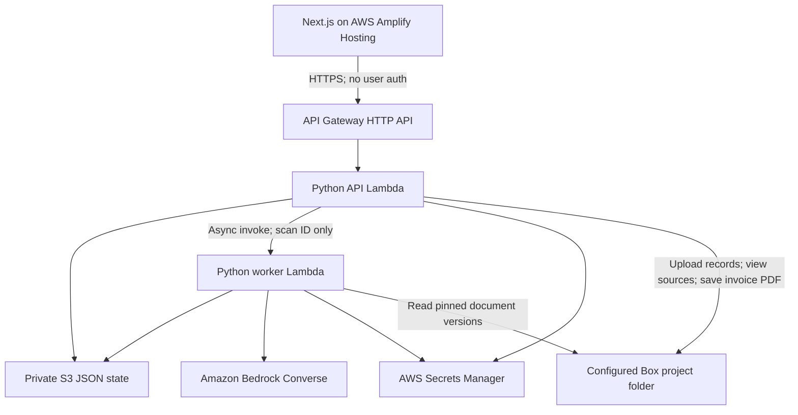

# ScopeGuard backend requirements and component plan

**Target:** hackathon demo. **AWS region:** `us-east-2`. **Frontend:** Next.js. **Backend:** Python. **Hosted services:** AWS and Box. **User authentication:** none.

This is the implementation plan for the approved project dashboard and invoice workflow. It describes required behavior, including work the current backend does not yet implement. It does not claim those features are already available.

## 1. Product outcome and agreed demo flow

ScopeGuard helps a construction company identify recorded work or approved changes that may have been missed in billing, review the supporting records, and prepare a supplemental invoice draft for customer review and sign-off.

The user is the construction company's project manager, working with accounting. The customer is the building owner or general contractor that hired the company. The application must distinguish a proposed charge, an approved change, an existing invoice balance, and an actual payment.

The demo must support this flow:

1. Select a project from compact project cards.
2. See the original agreement overview and open its source document before running an audit.
3. Add project records when needed, or use the records already in the configured Box folder.
4. Click **Run audit**; show real backend stages and the records being processed.
5. Show flagged discrepancy cards with an amount, reason, review status, and source references.
6. Click **Review**, inspect the source evidence in an overlay, add an internal comment, then dismiss the finding or add it to the invoice draft.
7. Repeat for other findings. Show the selected items and subtotal separately from existing invoice balances and retainage.
8. Generate one invoice draft containing the selected findings and an evidence appendix; download it and save the generated pack in Box.
9. Return later or refresh the audit without silently losing saved comments or invoice selections.

Generating a draft does not send it, record customer acceptance, establish entitlement to payment, or collect payment. For this demo, “for customer sign-off” means a prepared document with an acceptance section; actual signature collection is outside the build.

## 2. Scope decisions

| Area | Requirement |
| --- | --- |
| Authentication | No login, accounts, sessions, Cognito, JWT authorizer, user roles, or frontend Box OAuth. API calls need no user token or API key. |
| Service access | Lambda execution roles authorize AWS access. The backend uses the existing Box Client Credentials Grant app and its service account. These service credentials are still required. |
| Projects | One fully functional seeded project is sufficient. Additional project cards can be explicit layout placeholders. Add project is a nonfunctional demo control. |
| Concurrency | Support one active analysis per project. Do not introduce a distributed job platform. |
| Inputs | Small, text-readable PDF, UTF-8 TXT, and Markdown files. PDF pages retain their original page numbers. |
| Persistence | Private S3 JSON for application state; Box for original documents and generated invoice packs. No DynamoDB or relational database. |
| AI | Bedrock extracts and links evidence; Python verifies references and computes amounts. No separate vector database or Box AI dependency is required. |
| Async execution | API Lambda invokes worker Lambda asynchronously; the frontend polls for progress. No separately managed SQS queue or Step Functions workflow. |
| Logging | No custom logging system, dashboards, or logging workstream. Persist enough status and safe error information to show failures in the UI. |
| Integrations excluded | No accounting-system sync, payment gateway, automatic email, Box Sign, OCR, or production multi-tenant access model. |

The unauthenticated demo must use a dedicated fictional-data project folder. CORS controls browser origins; it is not an access-control mechanism. Requests must still be restricted to server-configured project folders and their known records.

## 3. Architecture and deployed components



| Component | Responsibility | Existing starting point |
| --- | --- | --- |
| Next.js / Amplify Hosting | Projects, agreement overview, audit progress, discrepancy review, source modal, invoice draft | `web/`; needs the approved screen structure and new API integration |
| API Gateway HTTP API | Route JSON, document uploads, source content, and PDF downloads; supply CORS responses | `template.yaml`; add routes and required headers |
| API Lambda | Validate requests, resolve configured projects, start scans, save reviews/selections, generate invoices, serve known files | `backend/api_handler.py` |
| Worker Lambda | Inventory Box files, extract/classify records, call Bedrock, validate findings, reconcile billing, persist progress | `backend/worker_handler.py`, `backend/scopeguard/analyze.py` |
| Bedrock | Structured facts, agreement summary, category suggestions, semantic work-item matches, grounded explanations | `llm.py`, `prompts.py`, `models.py` |
| Box adapter | Existing CCG authentication; folder inventory; version-pinned downloads; uploads; output-folder handling | `box_client.py` |
| S3 persistence | Project configuration, scan snapshots, extracted facts, findings, reviews, selections, generated-output references | `store.py`; extend the current scan-based layout |
| Reconciliation rules | Determine why a finding exists and whether its amount can enter a new invoice | `validate.py`; substantial additions needed |
| Invoice generator | Combine multiple selected findings into one PDF with evidence and approval disclosures | `packet.py` currently generates a single-finding packet |
| Secrets / IAM / SAM | Service credentials, deployment, permissions, configured project folder and model | `backend/config.py`, `scopeguard/config.py`, `template.yaml`, `samconfig.toml` |

Deploy regional application resources and address Secrets Manager and Bedrock through `us-east-2`. The current model setting uses a cross-region inference profile: calling Bedrock in `us-east-2` does not guarantee inference stays within that region. Choose a model/profile allowed by the account's policies; region selection alone does not resolve profile permissions.

## 4. Current backend versus required additions

The existing API contract in [api-contract.md](api-contract.md) describes the currently implemented endpoints. It remains the working contract until frontend and backend changes land together. The proposed interfaces below must not be mistaken for existing routes.

| Capability | Current state from source inspection | Required change |
| --- | --- | --- |
| Scan start, listing, polling | Implemented | Add project scope, cutoff, input snapshot, structured progress and explicit coverage |
| Box ingestion and PDF/TXT/MD extraction | Implemented | Enforce limits; retain every input outcome and extraction warning |
| Bedrock extraction and finding proposals | Implemented for scope/change-log comparisons | Add agreement summary, generated categories, invoices, approvals, payments and credit facts |
| Evidence/cost validation | Implemented foundation | Add billing eligibility, allocation checks and duplicate-charge prevention |
| Review edits | Existing confirmed/dismissed state, narrative/cost overrides and question resolutions | Add internal comments, invoice selection and stale-evidence handling |
| Review preservation | Separate AI/review objects protect edits when rewriting the same scan's finding | Preserve decisions across new scans using stable project-level work-item identity |
| Cross-scan identity | Finding ID currently includes `scan_id` | Add stable `work_item_id`; a fresh scan currently produces different finding IDs |
| Project baseline and cards | No project endpoints | Seed a project manifest and serve overview before the first financial audit |
| Source modal / categories | Box links and extracted document types exist | Add record inventory, generated category labels and content/page endpoints |
| Record upload | No application upload route | Upload supported files to the configured project's Box folder |
| Billing/payment reconciliation | Not implemented end to end | Model approved, billed, credited, paid and withheld amounts separately |
| Multi-item invoice | Not implemented | Selection persistence, eligibility checks, immutable invoice snapshot and PDF |
| Output storage | Single-finding packet upload to Box exists | Reuse its adapter for combined invoice packs and downloadable output |

Implementation status above is based on repository source, not a verification of deployed services.

## 5. Functional backend requirements

### 5.1 Project configuration and original agreement

- **PRJ-01:** Serve a project ID, name, contractor, customer, dates, currency, Box folder mapping, last completed audit, audit state and review counts. Store configured IDs; never derive Box folders from user-entered names.
- **PRJ-02:** Serve the original agreement summary: original contract amount, work inclusions, exclusions, pricing basis, change-approval terms, and payment/retainage terms when present. Unstated values remain unknown.
- **PRJ-03:** Every material summary field must carry a source reference. The original-scope button must identify the actual Box file and version.
- **PRJ-04:** Project context must exist before the first financial audit. For the demo, seed a reviewed baseline manifest grounded in the fictional signed agreement; refresh its AI-derived fields during ingestion. Do not require a completed discrepancy audit just to render the overview.
- **PRJ-05:** If the agreement changes, retain the prior scan's baseline version. Flag the new baseline and any affected findings for review.

### 5.2 Source records and uploads

- **DOC-01:** Inventory only files in the configured input folder. Paginate Box listings. The demo can use a flat folder; recursive folder traversal is not required.
- **DOC-02:** Record file ID, version ID, filename, extension/MIME type, byte size, modification time, page count, ingestion status and any warnings. Do not silently omit files that failed ingestion.
- **DOC-03:** Exclude generated invoice/packet folders from audit inputs so outputs never become evidence for themselves.
- **DOC-04:** Let the user upload one supported file at a time. Backend uploads to the configured Box folder, returns its real IDs, and marks the current audit as having new input available. Uploading alone does not run an audit.
- **DOC-05:** Reject an oversized, unsupported, empty or malformed upload with a useful error. Preserve original filenames as metadata, but sanitize filenames for generated outputs and HTTP headers. Escape TXT/Markdown when rendering; never execute document HTML.
- **DOC-06:** Preserve version-pinned references. The [Box content API supports a version parameter](https://developer.box.com/reference/get-files-id-content/); source review must not silently display a newer version than the one analyzed.
- **DOC-07:** Expose categories generated from document meaning, not just extensions. Example labels are Original agreement, Approvals, Field records, Billing, Change instructions and Pricing. These are examples, not a mandatory fixed taxonomy.
- **DOC-08:** Store a category ID, display label and classification basis with each record. Normalize equivalent labels, keep category IDs stable where possible, and put unreadable/unclassified files in an explicit Unclassified category.
- **DOC-09:** Support filtering records by category. Return records and categories even when no discrepancies are found.

### 5.3 Source-record overlay support

- **VIEW-01:** A finding reference must open the correct record and page without requiring the teammate to sign into Box.
- **VIEW-02:** Backend resolves an inventoried record to its pinned Box content. Never accept an arbitrary external URL, arbitrary Box folder, or unrestricted Box file ID as a download target.
- **VIEW-03:** Serve known PDF bytes with `application/pdf` and an inline filename. Serve TXT/MD as plain text. Return the validated excerpt and page metadata separately for highlighting/context.
- **VIEW-04:** Support page navigation and selecting between records cited by one finding. Text excerpts can be highlighted; exact pixel-level annotation on PDFs is optional.
- **VIEW-05:** The modal must work through backend content access. An optional “Open in Box” link may still require a Box account and cannot be the only evidence-viewing mechanism.
- **VIEW-06:** Do not return a Box enterprise access token or client secret to the browser. CCG remains server-side; [Box documents this as server authentication](https://developer.box.com/guides/authentication/client-credentials/).
- **VIEW-07:** Missing versions and inaccessible files produce a clear unavailable-source result. Retain the finding's reference and warn that the source cannot currently be opened.

### 5.4 Audit execution and progress

- **AUD-01:** First action reads **Run audit**. After a completed audit, the action reads **Refresh audit**. Backend returns the state needed to select the label.
- **AUD-02:** Create a scan ID and immutable input manifest before invoking the worker; return `202` promptly. Pass IDs to the worker, not document bytes.
- **AUD-03:** Manifest records project ID, cutoff date, file/version IDs, baseline version, requested time and analysis/prompt version. Snapshot the included records so results can be explained later.
- **AUD-04:** Enforce one active scan per project using an S3 conditional-write lease with scan ID, expiry and revision. A duplicate start returns `409` with the active scan ID; the UI resumes polling that scan.
- **AUD-05:** Persist states `queued`, `running`, `completed`, `failed`. Keep coverage completeness and warnings separate from execution status: a run can finish successfully while missing some evidence.
- **AUD-06:** Persist structured stages `reading_box_records`, `connecting_evidence`, `checking_billing`, `findings_ready`, plus progress, file counts, last update and a short current event with an optional source reference.
- **AUD-07:** Events reflect real work completed by the backend. Do not animate fabricated document matches in the integrated demo. Progress percentages are estimates, not confidence scores.
- **AUD-08:** Poll approximately every two seconds while active; stop at a terminal state. A refresh must not erase the last completed results while the new scan is running.
- **AUD-09:** Update the project's latest completed scan only after results are persisted. On refresh failure, retain the previous completed audit and its reviews.
- **AUD-10:** Use a lease/heartbeat and deadline to detect a worker that timed out before recording failure. Surface a stale run as failed and allow a new scan without requiring a separate scheduler.
- **AUD-11:** Treat duplicate worker deliveries as possible even with function-error retries set to zero. Claim a scan execution lease, use idempotent writes, and never duplicate output generation. AWS explicitly documents [possible duplicate asynchronous deliveries](https://docs.aws.amazon.com/lambda/latest/dg/invocation-async-error-handling.html).

### 5.5 Bedrock extraction, matching and grounding

- **AI-01:** Use the existing `boto3` Bedrock Converse integration, with structured output validated by Pydantic. Keep model ID, prompt version and token limits configurable. [Converse supports tool use for structured interactions](https://docs.aws.amazon.com/bedrock/latest/userguide/conversation-inference.html).
- **AI-02:** Classify each readable document and extract facts: agreement inclusions/exclusions, instructions, approvals, work completion, quantities/rates, invoice lines and revisions, credit notes, remittances, deductions and retainage.
- **AI-03:** Every extracted fact retains its exact quote, file/version IDs, page, fact type, amount/currency when stated, and date/entity references when available. Never infer a missing approval or payment from silence.
- **AI-04:** Match references across wording differences using work description, location, dates, change number, invoice reference and amounts. Preserve contradictions and uncertain matches as questions for the reviewer.
- **AI-05:** Python verifies that cited files/pages exist and quotes are supported by extracted source text. Keep the existing normalization/quote verification foundation; exclude unverified passages from generated evidence appendices.
- **AI-06:** Draft explanations from verified facts and deterministic calculations. Explanations must say what differs, which records support it, what is missing, and why the proposed amount was calculated.
- **AI-07:** Treat document text as data. Embedded instructions must not change system behavior, choose new folders, call external tools, or override review decisions. AI receives no secrets and cannot submit invoices or grant approval.
- **AI-08:** Reject malformed or truncated model output. Permit a bounded retry within the scan deadline, then record an explicit failure or incomplete coverage; never substitute invented facts.
- **AI-09:** Bound the demo dataset to the model context budget. If a document/context exceeds the configured budget, report it; do not silently truncate away evidence and claim a complete audit.

### 5.6 Reconciliation and financial rules

- **FIN-01:** A change appearing in the change-order log does not mean it has been billed. Determine authorization, performed work, billing and payment as separate dimensions.
- **FIN-02:** Support finding types `approved_unbilled`, `scope_change_proposed`, `authorization_unresolved`, `invoice_balance_unresolved` and `needs_information`. Track reconciled work in the audit summary without presenting it as a new charge.
- **FIN-03:** For approved work missing from supplied billing, compare the approved work/amount against related invoice lines and credits. Use “not found in supplied records,” rather than asserting it was never billed.
- **FIN-04:** Match invoices by document/line identity and revision relationships. A revised or cumulative invoice must not be added to its prior version as if both were new charges.
- **FIN-05:** Payment allocations require evidence. If a remittance cannot be reliably allocated, show an unresolved balance instead of inventing a match. Unpaid does not automatically mean overdue.
- **FIN-06:** Keep billed amounts, payments, credits, retainage and other documented withholding separate. Unknown allocations stay unknown; absence of payment records is not a zero-payment assertion.
- **FIN-07:** In the simple demo case, calculate an invoice balance as billed amount minus allocated payments minus applicable credits. Show retainage as an identified portion/explanation of that balance, not an additional charge or a second subtraction. More complex net/cumulative terms require explicit document-specific treatment.
- **FIN-08:** New invoice eligibility must exclude work already billed, prior invoice balances, credited/rejected work, and retainage. A customer may still owe money on these items, but issuing a new charge would double count them.
- **FIN-09:** Proposed or unapproved extra work can be selected only as an explicitly labeled proposal for customer acceptance. It must not become “approved” when the user clicks Add to invoice.
- **FIN-10:** Quantities and money use decimal strings in JSON and Python `Decimal` for arithmetic. Preserve currency; the demo uses USD only. Round currency half-up to cents. Reject negative or nonfinite new-charge amounts; represent credits separately.
- **FIN-11:** A unit price must have a stated basis. Use a verified approved lump sum or supported quantity × rate. Apply markup only when supported by the agreement, and never apply it twice to an all-in quoted amount. Unknown quantities/rates block pricing rather than becoming zero.
- **FIN-12:** Prevent two findings for the same work from entering the same draft. A non-dismissed duplicate/overlap question blocks final draft generation until resolved.

### 5.7 Findings, comments and refresh preservation

- **REV-01:** A discrepancy card returns its ID, stable work-item ID, title, short reason, proposed amount or unknown amount, approval status, review status and source count.
- **REV-02:** Review detail returns agreement grounding, changed/completed work, billing comparison, cost calculation, evidence references and unresolved questions. Keep financial and review status separate.
- **REV-03:** Allow internal comment editing/saving, confirmed review, dismissal and invoice selection/removal. Persist changes in S3 and return the saved state.
- **REV-04:** Internal comments are not Box file comments and must not appear in the customer invoice. If customer-facing wording can be edited, store it in a separate field.
- **REV-05:** Add to invoice records a reviewed selection; it does not record customer approval. Unpriced findings can remain under review but cannot enter a priced invoice draft.
- **REV-06:** Use a project-level `work_item_id` to carry decisions across scans. Do not use `scan_id` as part of that stable identity. Maintain scan-local finding IDs for evidence snapshots.
- **REV-07:** Match refreshed findings to prior work items using source/entity references and the work's identity. Do not depend solely on an LLM-generated title/key. Ambiguous matches require review rather than automatic comment transfer.
- **REV-08:** Preserve comments and selection intent when evidence changes, but mark the finding `needs_revalidation` and block invoice generation until the user reconfirms the changed evidence/amount. Unchanged findings retain their review state.
- **REV-09:** Save review and draft revisions with conditional writes. Return `409` on a revision conflict so one teammate's update does not silently overwrite another's. No user accounts or per-user attribution are required.

### 5.8 Invoice draft and evidence pack

- **INV-01:** Maintain one current draft per project with selected work-item IDs, selected finding snapshots, item order, customer-facing descriptions, draft revision and calculated subtotal.
- **INV-02:** The sidebar displays selected items, remove actions and subtotal. Calculate totals server-side from current reviewed data; never trust a total sent by the browser.
- **INV-03:** Generate one supplemental invoice PDF from all selected eligible findings. Revalidate their evidence, price, review state and latest audit linkage at generation time.
- **INV-04:** Include contractor/customer, project, invoice draft reference, date, currency, each line's work description and amount, subtotal, approval/proposal disclosures, and a customer acceptance section.
- **INV-05:** Include an evidence appendix organized by invoice line. Each entry has a filename, pinned version reference, page, verified excerpt and an explanation linking it to the charge. Embed the excerpts so the customer can understand the pack without accessing the private Box folder.
- **INV-06:** Clearly label the document **Draft — for customer review and sign-off** and **Not sent**. Distinguish previously approved changes from proposals awaiting acceptance. Omit internal comments.
- **INV-07:** Show taxes, payment terms and retainage only when supplied/configured. Do not invent tax treatment, due dates or signature status. For the demo, use the selected-items subtotal and clearly identify any terms still requiring completion.
- **INV-08:** Save a generation snapshot containing scan ID, draft/review revisions, line amounts, source versions, generated time, content hash and Box file/version IDs. Subsequent edits create a new generation; do not silently mutate a prior PDF.
- **INV-09:** Support separate Generate, Download, and Save to Box actions. Generation creates a private temporary PDF in S3 with a configurable expiry (for example 24 hours); Save to Box uploads that exact PDF to the configured output folder. Persist the Box result and use it for later downloads after the temporary artifact expires.
- **INV-10:** Make generation and save operations idempotent for the same request key and snapshot. On an uncertain Box upload outcome, reconcile the expected output identity before uploading again. Do not overwrite original records or create public shared links.
- **INV-11:** Disable generation for an empty selection, unresolved pricing, stale evidence, duplicates, or a failed/incomplete required comparison. Return actionable validation messages. Missing customer acceptance alone is allowed for a clearly labeled proposal draft.
- **INV-12:** Repeated saving returns the existing Box result for that generation. Changed line items/revisions require a new generation and filename.

## 6. Proposed API additions and extensions

All JSON endpoints use decimal strings for amounts/quantities and ISO 8601 UTC timestamps; business cutoff dates use `YYYY-MM-DD`. No `Authorization` header is required. Preserve the current `{ "error": "message" }` shape; optional `code` and `details` fields can add actionable context without breaking the existing client.

| Method and route | Purpose | State |
| --- | --- | --- |
| `GET /projects` | List configured project cards and audit/review counts | New |
| `GET /projects/{project_id}` | Agreement overview, sources, latest audit, active scan, draft summary | New |
| `GET /projects/{project_id}/records?category_id=...` | Known records, category list, ingestion status and source versions | New |
| `POST /projects/{project_id}/records` | Multipart upload of one supported file to Box | New |
| `GET /projects/{project_id}/records/{file_id}/content?version_id=...` | Inline PDF/plain-text content for an allowlisted record version | New |
| `GET /projects/{project_id}/records/{file_id}/pages/{page}?version_id=...` | Extracted page text and validated references for the source modal | New |
| `POST /scans` | Start/refresh an audit; accept project ID, cutoff and request key | Extend existing |
| `GET /scans?project_id=...&limit=20` | Reopen saved project scans without reprocessing documents | Extend existing |
| `GET /scans/{scan_id}` | Progress, coverage, warnings, result summary and findings | Extend existing |
| `PATCH /findings/{finding_id}` | Existing review update plus comments and stale-evidence confirmation | Extend existing; retain `scan_id` |
| `GET /projects/{project_id}/invoice-draft` | Current selected lines, revision, subtotal and blockers | New |
| `PATCH /projects/{project_id}/invoice-draft` | Add/remove/reorder reviewed work items; validate expected revision | New |
| `POST /projects/{project_id}/invoice-generations` | Validate selection and generate an immutable PDF snapshot | New |
| `GET /projects/{project_id}/invoice-generations/{generation_id}/content` | Download the generated PDF | New |
| `POST /projects/{project_id}/invoice-generations/{generation_id}/save-to-box` | Idempotently save the generated PDF to Box | New |
| `POST /packets` | Existing single-finding packet export | Keep for compatibility; not the combined-invoice endpoint |

For the transition, `{}` on `POST /scans` continues to mean the configured demo project. Reject unknown project IDs. `selected_file_ids` is optional and, if supplied, must be a subset of the configured project's records. Baseline and required billing records cannot be silently excluded from a comparison claimed as complete.

Example audit request and response:

```json
{
  "project_id": "riverside",
  "cutoff_date": "2026-10-16",
  "request_id": "demo-audit-001"
}
```

```json
{
  "scan_id": "scan_001",
  "project_id": "riverside",
  "status": "queued"
}
```

Example progress fields added to the current scan response:

```json
{
  "stage_id": "checking_billing",
  "stage": "Checking CO-001 against supplied invoices",
  "progress": 78,
  "files_processed": 10,
  "files_total": 10,
  "updated_at": "2026-10-16T23:00:00Z",
  "current_event": {
    "message": "Comparing the approved circuits with INV-014 and INV-015",
    "box_file_id": "example-file-id",
    "box_version_id": "example-version-id",
    "page": 1
  },
  "coverage": { "complete": true, "warnings": [] }
}
```

Example draft update; line amounts are resolved and calculated by the backend:

```json
{
  "expected_revision": 3,
  "scan_id": "scan_001",
  "selected_work_item_ids": ["work_circuits", "work_fixtures"]
}
```

Use `400` for malformed requests, `404` for unknown scoped resources, `409` for active scans/revision conflicts/stale selections, `413` for size limits, `415` for unsupported media, `422` for generation blockers, and a safe `5xx` error for upstream failures. `OPTIONS` must work without auth. A known project record that Box denies should produce an unavailable-source error, not trigger an application login flow.

## 7. Data model requirements

| Entity | Minimum fields |
| --- | --- |
| Project | `project_id`, name, contractor, customer, dates, USD currency, input/output folder IDs, baseline references, latest completed scan ID, active scan ID |
| Agreement overview | Original value, inclusions, exclusions, pricing/change/payment terms, source references, baseline version, reviewed/seeded status |
| Source record | File/version IDs, name, type, size, modified date, category ID/label, page count, content hash, ingestion outcome/warnings |
| Extracted fact | Fact ID/type, work/entity references, date, quote/page/source version, verified flag, quantity/rate/amount/currency where stated |
| Scan | Project/scan IDs, input manifest, cutoff, state/stage/progress, timestamps, coverage, safe error, model/prompt version, summary |
| Work item | Stable project-level ID, normalized description/location, related change references, prior/current finding links |
| Finding | Scan-local ID, work-item ID, finding type, agreement/work/approval/billing/payment references, explanation, amount, currency, eligibility/blockers |
| Financial state | Approved amount, invoiced amount, credits, allocated payments, retainage/other withholding, unresolved balance; unknown values nullable |
| Review | Work-item ID, review state, internal comment, optional customer wording/cost overrides, resolved questions, evidence fingerprint, revision, timestamp |
| Invoice draft | Project ID, selected work-item IDs and scan snapshots, item order, server subtotal, blockers, revision, timestamp |
| Invoice generation | Generation/request IDs, immutable draft snapshot, PDF hash/location, source references, state, timestamps, Box file/version IDs when saved |

Keep authorization status (`approved`, `pending`, `not_found`, `unclear`), review status (`unreviewed`, `reviewed`, `dismissed`, `needs_revalidation`), and invoice selection separate. AI confidence is not customer approval. Unknown monetary values must not be serialized as `0.00`.

## 8. S3 layout and write ownership

Retain the current `scans/` layout to minimize migration. Add project-level objects for state that survives a refresh:

```text
projects/<project_id>/project.json
projects/<project_id>/baseline.json
projects/<project_id>/active-scan.json
projects/<project_id>/records/<file_id>/<version_id>/metadata.json
projects/<project_id>/records/<file_id>/<version_id>/pages.json
projects/<project_id>/reviews/<work_item_id>.json
projects/<project_id>/invoice-draft.json
projects/<project_id>/invoice-generations/<generation_id>/manifest.json
projects/<project_id>/invoice-generations/<generation_id>/draft.pdf
scans/<scan_id>/meta.json
scans/<scan_id>/manifest.json
scans/<scan_id>/execution-lease.json
scans/<scan_id>/facts.json
scans/<scan_id>/files/<file_id>.json
scans/<scan_id>/findings/<finding_id>/ai.json
scans/<scan_id>/findings/<finding_id>/review.json     # legacy scan-local review
```

- Worker owns machine facts/findings and scan progress. API owns reviews, draft selections and generation requests. Machine updates must never overwrite human edits.
- Use S3 ETags/conditional writes for leases, draft/review revisions and generation claims. Handle create/update conflicts explicitly; S3 is not a multi-object transaction database.
- The project-level review becomes authoritative after migration. Legacy scan-local reviews remain readable; migrate unambiguous matches rather than discarding existing decisions.
- Cache extraction by file ID + version ID + extraction/prompt version. An unchanged refresh may reuse extraction while rerunning the comparison; report cached reuse honestly in progress.
- Keep S3 private. Original documents remain in Box. Extracted text/facts in S3 are application derivatives; only temporary generated PDFs are additionally stored there for download before saving to Box.

## 9. Runtime limits, reliability and errors

The following are proposed demo limits, not claims about platform maximums:

| Limit | Demo requirement |
| --- | --- |
| Active audits | One per project |
| Input files | Up to 20 supported records per scan; report excess files explicitly |
| Single uploaded/viewed file | Up to 4 MiB of raw bytes; account for multipart and base64 overhead |
| Dataset size | Up to 40 MiB and 200 text-readable PDF pages total, also bounded by the model context budget |
| API timeout | Keep the existing 29-second API Lambda configuration; no long analysis in an HTTP request |
| Worker timeout | Keep the existing 900-second worker configuration; finish or checkpoint failure before the deadline |
| Interactive goal | Target a rehearsed 10-record audit within two minutes; this is a target to measure, not a promised latency |
| Generated PDF | Fit within the content endpoint's 4 MiB demo cap; fail clearly if it exceeds it |

The 4 MiB proxy cap is a conservative implementation choice to leave room under Lambda's buffered synchronous payload limit after encoding; [AWS documents the invocation limits](https://docs.aws.amazon.com/lambda/latest/dg/gettingstarted-limits.html). Do not label a buffered proxy as unlimited streaming. Large-file direct upload/download infrastructure is deferred.

- Budget Box/Bedrock calls and bound retries. Keep SDK retry ownership in one place, honor Box `Retry-After` when exposed, and stop before the scan deadline. Do not repeatedly retry unchanged permission failures.
- Distinguish unsupported type, unreadable PDF, missing baseline, Box access failure, model failure and incomplete billing records. Persist file-level outcomes in the scan's coverage.
- If the baseline cannot be read, fail the audit. If another required comparison source fails, show the findings as incomplete and block affected invoice lines. Never complete with zero readable documents and “no discrepancies.”
- Avoid surfacing raw SDK exception bodies, credentials or signed URLs. Return a safe error code and useful next action.
- PDF generation should remain a small bounded operation in API Lambda for the demo. If generation/upload cannot finish within the API timeout during implementation, reuse the existing worker for an asynchronous invoice task and return `202`; no additional queue service is required. Finalize that contract before connecting the UI.

## 10. Configuration and service permissions

| Setting | Required value / purpose |
| --- | --- |
| Deployment region | `us-east-2` in SAM and local AWS configuration |
| `AWS_PROFILE` | `default` for local development; not deployed to Lambda |
| `AWS_DEFAULT_REGION` | `us-east-2` locally; Lambda uses the runtime-provided `AWS_REGION` |
| `DATA_BUCKET` / `DATA_PREFIX` | Private S3 application state bucket and optional prefix |
| `BOX_SECRET_ID` / `BOX_SECRET_ARN` | `scopeguard/box/ccg` or its actual ARN in `us-east-2`; both existing loaders must resolve the same secret |
| `BOX_FOLDER_ID` | Configured demo input folder, mapped to the seeded project |
| Output folder | Dedicated project output subfolder; keep the existing `ScopeGuard Packets` folder or configure an explicit equivalent |
| `BEDROCK_MODEL_ID` | Account-authorized model/profile usable from the `us-east-2` runtime |
| `BEDROCK_MAX_TOKENS` | Existing token budget, constrained to the selected model and scan workload |
| `WORKER_FUNCTION_NAME` | API's async scan target |
| `ALLOWED_ORIGIN` | Amplify frontend origin; allow localhost in the local setup |
| `NEXT_PUBLIC_API_URL` | API base URL only; no secret values in frontend variables |
| `STORE`, `BOX_MODE`, `LLM_MODE` | Live demo: `s3`, `box`, `bedrock`; local fallback: `memory`, `local`, `fake` |

Secrets Manager JSON uses exactly `BOX_ENTERPRISE_ID`, `BOX_CLIENT_ID`, and `BOX_CLIENT_SECRET`. Keep values out of this document, Git, S3 response objects and frontend bundles. The authorized Box service account must have access to the dedicated input/output folders.

API role needs scoped S3 read/write/list, secret retrieval for Box operations, and permission to invoke the configured worker. Worker role needs scoped S3 read/write/list, secret retrieval and `bedrock:InvokeModel` for the chosen model/profile. Include KMS decrypt permission only when the resources use a customer-managed key that requires it. No application IAM user or administrator policy is required.

Use the existing Python 3.12/arm64 SAM packaging, `boto3`, `box-sdk-gen` through `box_sdk_gen`, Pydantic, `pypdf`, and `fpdf2`. Preserve the repository's Box SDK version/interface; do not mix legacy SDK examples into the generated client.

If the Box secret already exists outside the stack, reference it or deliberately import/manage it; do not attempt to create another resource with the same name. Update API Gateway CORS to support any new content headers and revision mechanisms actually used. Keep binary handling correct for PDFs/multipart requests.

## 11. Implementation work packages

| Order | Work package | Main modules | Completion outcome |
| --- | --- | --- | --- |
| 1 | Domain/schema agreement | `models.py`, `serialize.py`, `docs/api-contract.md`, `web/lib/types.ts` | Shared project, financial, review and invoice schemas; old/new routes explicitly documented |
| 2 | Project and records | Proposed `projects.py`, `records.py`; `box_client.py`, `store.py` | Seeded baseline before audit; upload, categories and version-pinned source viewer |
| 3 | Audit lifecycle | `api_handler.py`, `analyze.py`, `worker_handler.py`, `store.py` | Real stages, coverage, leases, request deduplication and usable failure states |
| 4 | Extraction and reconciliation | `prompts.py`, `llm.py`, `models.py`, `validate.py`; proposed `reconcile.py` | Approved/unbilled versus already billed/payment/retainage distinctions with grounded amounts |
| 5 | Review and refresh | `serialize.py`, `store.py`; proposed `reviews.py` | Internal comments, stable work IDs, preserved selections and revalidation after evidence changes |
| 6 | Combined invoice | Evolve `packet.py` or add `invoice.py`; new handlers/store methods | One reviewed multi-item PDF, download, idempotent save to Box |
| 7 | Frontend connection | `web/lib/api.ts`, `web/lib/types.ts`, dashboard/detail components | Approved UI uses real API states and content rather than the standalone prototype's simulations |
| 8 | Deployment wiring | `template.yaml`, `samconfig.toml`, Amplify settings | New routes/permissions, region consistency, live service modes, no user auth |

Proposed new module names are implementation suggestions. The required behavior and data ownership matter more than the filenames.

## 12. Demo completion criteria

The implementation is ready for the demo when the following conditions are met.

- A teammate can open the deployed app, choose Riverside and use the workflow without logging in.
- The agreement overview is visible before the first audit, and its source opens in the overlay.
- Real Box records appear under All source records, with generated category filters and pinned content/page references.
- Run audit shows real Box reading, AI matching and billing-check stages; it becomes Refresh audit after completion.
- The demo identifies an approved completed change with no matching charge in supplied invoices; a separately proposed quantity change; and work with unresolved authorization.
- A previously billed item, a partially paid invoice balance and legitimate retainage do not become new invoice charges.
- Review comments survive page reload; unchanged decisions survive a new scan; changed evidence requires reconfirmation.
- A user can review and select several distinct findings, remove one, and see an accurate server-calculated subtotal.
- The combined PDF contains selected lines, verified source excerpts and approval/proposal labels, and excludes internal comments.
- Download returns the generated document; Save to Box creates one output per generation and does not overwrite input records.
- A failed source/model call produces an actionable status, not an empty successful audit. Repeated clicks do not create duplicate active scans or duplicate invoices.
- The live demo uses Box and Bedrock. A separately labeled local/fake mode remains available for development or a disclosed fallback.

### Fictional walkthrough amounts

| Record situation | Required result | New invoice treatment |
| --- | --- | --- |
| CO-001, two completed circuits, approved at `$8,500.00`, no matching line in supplied invoices | `approved_unbilled` with approval, completion and invoice comparison evidence | Eligible after user review |
| Signed scope has 24 fixtures; instruction requests 26; supported all-in quote is `$800.00` per extra fixture | `$1,600.00` proposal, acceptance pending | Eligible only as a clearly labeled proposal after review |
| Weekend excluded; instruction requests Saturday work; nine supported hours at `$100.00` | `$900.00` proposed cost with authorization unresolved | User must acknowledge the unresolved authorization; retain proposal disclosure |
| Existing `$1,500.00` invoice with `$1,000.00` allocated payment and no other adjustment | `$500.00` unresolved existing balance | Excluded from new charges |
| Documented `$6,250.00` retainage from original-scope billing | Separately identified withheld amount | Excluded from new charges |

If all three eligible proposed/approved additions are reviewed and selected, the draft subtotal is `$11,000.00`. This is the selected draft amount, not a guaranteed recovery figure. The supplied document set must contain the evidence needed for each demonstration; filenames and values in the old backend fixtures currently differ from this walkthrough.

## 13. Reference documents

- [Current API contract](api-contract.md): implemented interfaces and current frontend/backend types.
- [Project overview](project-overview.md): the Google Doc snapshot; this backend plan incorporates the newer approved discrepancy-card and invoice-builder flow.
- [Interactive prototype](https://scopeguard-team-prototype.elvenspice11.chatgpt.site): approved screen flow, currently browser simulations.
- [Box CCG](https://developer.box.com/guides/authentication/client-credentials/) and [versioned file content](https://developer.box.com/reference/get-files-id-content/): service authentication and source retrieval.
- [Bedrock Converse](https://docs.aws.amazon.com/bedrock/latest/userguide/conversation-inference.html): model invocation and structured interactions.
- [Lambda quotas](https://docs.aws.amazon.com/lambda/latest/dg/gettingstarted-limits.html) and [async error handling](https://docs.aws.amazon.com/lambda/latest/dg/invocation-async-error-handling.html): payload/runtime bounds and duplicate-delivery behavior.
