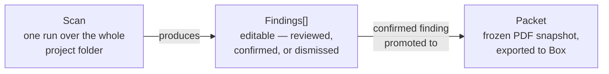
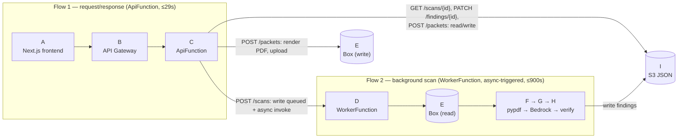

# ScopeGuard — project understanding notes (Jimmy)

## Demo framing vs. README framing (recorded 2026-10-17, before editing README)

The README describes a fairly general capability: scan a Box project folder, find any extra work
missing from the change-order log, across whatever categories show up (scope changes, written
instructions, daily reports, etc.).

Jimmy's framing of what we actually want to demo is narrower and more concrete. Two steps:

1. **Ingest documents** — pull everything from the Box project folder (scope/subcontract, specs,
   instructions, daily reports, timesheets, receipts, rate sheet, existing change-order log).
2. **Scan and reconcile** — compare what's been billed/paid against what should have been billed,
   and surface the gap. Two concrete example patterns:
   - **Increased scope, hours not billed**: more labor hours were worked than the original scope
     called for, but that increase never made it into a bill/change order.
   - **Hardware substitution, cost delta not billed**: a specified part/material had to be swapped
     for a replacement (e.g. unavailable door hardware), the replacement cost more than the
     original spec, and that delta never made it into a bill/change order.

**Headline value for the demo**: not just "AI can find missed changes" in the abstract, but
**speed** — AI can scan through a pile of documents and reconcile paid vs. owed far faster than a
PM manually cross-referencing everything by hand.

Not yet reconciled with the README or the code — just recording the gap for now. Decision on
whether/how to narrow the README's framing (or the demo data / prompts) to match is still open.

## Data model: Scan → Findings → Packet

The core object lifecycle, independent of the AWS plumbing:



- **Scan** — one analysis pass over the *entire* Box project folder. Not raw data — it's already a
  structured, AI-produced reconciliation report (narrative, cost breakdown, evidence per item) — just
  not yet finalized.
- **Finding** — one line item within a scan's report: one discrepancy (e.g. unbilled extra labor
  hours, or an unbilled hardware-substitution cost delta — see the two example patterns above).
  **Editable** — a PM reviews it via `PATCH /findings/{id}`, can correct the AI's numbers/narrative,
  answer open questions, and set its status to `confirmed`, `dismissed`, or leave it `unreviewed`.
- **Packet** — a **confirmed** finding, promoted into a frozen PDF and uploaded back to Box. Scoped to
  *one* finding, not the whole scan — a scan with 3 findings can produce up to 3 independent packets,
  each confirmed/exported on its own schedule. "Frozen" is per-packet, not permanent on the finding:
  if a PM edits a finding after generating a packet and regenerates, that produces a *second* packet
  (packets are a list, not a single slot) — so a finding can be promoted more than once over time,
  each time producing its own new frozen snapshot.

Why this distinction matters for the demo: the **scan** is the thing that proves "AI found this
faster than a human could" (speed); the **packet** is the thing that actually gets used to go bill
the client (the business payoff). The app's whole review workflow exists in the gap between the two —
AI proposes, a human decides what's real, only what's confirmed becomes a real, submittable document.

## Architecture diagram (Mermaid version of README's ASCII diagram)

Same content as the README's architecture block, redrawn for readability. Not swapped into the
README itself yet.

Redrawn as what it actually is: **two separate flows**, linked by one fire-and-forget trigger, not
one straight pipeline. Flow 1 is request/response (must finish in 29s). Flow 2 is a background job
(up to 900s) that Flow 1 kicks off but never waits for — the frontend finds out it's done by
polling `GET /scans/{id}`, which just reads whatever Flow 2 has written to S3 so far.



`E` (Box) appears **twice on purpose** — same real system, drawn once per flow so each connection stays short and unambiguous instead of one edge arcing across the whole diagram. (An earlier draft had a single shared `E` node; `C`'s direct edge to it visually got lost behind `D`'s edge to the same node, since the layout ranked it two hops from `C`.)

`POST /packets` reads the scan + finding from S3 first (to check `review.status == "confirmed"` and pull the data to render), then renders the PDF and uploads it to Box. (The code also writes the new packet's metadata back to S3 as a last step, so `GET /scans/{id}` can show it later — left out of the diagram for now to keep it simple.)

- **A**: Next.js frontend — web static export to Amplify
- **B**: API Gateway — HTTP API
- **C**: ApiFunction — Lambda, Python 3.12, arm64, 29s timeout. Routes: `POST /scans`, `GET /scans/{id}`, `PATCH /findings/{id}`, `POST /packets`. Only `POST /scans` ever touches WorkerFunction (async, fire-and-forget); the other 3 routes are self-contained.
- **D**: WorkerFunction — Lambda, 900s timeout, 2GB mem, async invoke only, no retries. Only entry point is the async invoke from C's `POST /scans` handler.
- **E**: Box (box-sdk-gen, CCG auth) — touched by **two different flows**: WorkerFunction reads project documents from it; ApiFunction separately writes the generated PDF packet back to it (`POST /packets`), with no WorkerFunction involvement.
- **F → G → H**: pypdf (extracts text per page) → Bedrock (Converse API, tool use = structured output, pydantic-validated) → Python verification (`validate.py`)
  - **G1**: per document — classify + extract facts (quotes + pages)
  - **G2**: all facts — group, compare to scope, match CO log → propose findings
  - **G3**: per finding — draft narrative + timeline, from verified facts only
- **I**: S3 JSON — scans / files / findings / packets. Shared state: Flow 2 writes findings here as it works; Flow 1 reads it back out (polling) and writes reviewer edits here directly, without ever involving Flow 2.

## Deployment: SAM (backend) and Amplify (frontend) — two separate pipelines

### SAM

**What it is.** SAM (AWS Serverless Application Model) is a thin extension of CloudFormation, not a
separate deployment engine. `template.yaml` is plain CloudFormation plus a few shorthand resource
types (`AWS::Serverless::Function`, `AWS::Serverless::HttpApi`) that expand into more verbose raw
CloudFormation at deploy time. You can freely mix shorthand and raw CloudFormation types in the same
file — this project does, e.g. `DataBucket` (`AWS::S3::Bucket`) and `BoxSecret`
(`AWS::SecretsManager::Secret`) sit right next to the `AWS::Serverless::Function` definitions.

**How it fits this project.** `template.yaml` is the single source of truth for backend
*infrastructure* (not app logic): it defines `ApiFunction` and `WorkerFunction` (the two Lambdas),
`DataBucket` (S3, app data), `BoxSecret` (Secrets Manager, Box CCG creds), and the `HttpApi` routes.
Critically, it also declares the IAM permissions connecting these pieces — e.g. `WorkerFunction`'s
`bedrock:InvokeModel` policy ([template.yaml:68-76](../template.yaml#L68-L76)) is what actually lets
the Python code's `boto3` Bedrock calls succeed; without it they'd get `AccessDenied`. Neither Lambda
has a `VpcConfig`, so both run in AWS's default managed network with free outbound internet — that's
why they can reach Box's and Bedrock's public endpoints with zero extra networking setup (no VPC,
subnets, or NAT gateway to configure).

**Who actually deploys.** You write/read SAM (the YAML). `sam build` packages the Lambda code;
`sam deploy` hands the transformed template + packaged code to **CloudFormation**, which is what
actually calls the real AWS APIs (`lambda:CreateFunction`, `apigateway:CreateApi`, etc.) and tracks
everything as one named "stack." SAM itself never talks to AWS to provision resources — it's the
authoring/packaging layer; CloudFormation is the engine.

**Build and deploy commands** (from the README):

```bash
sam build
sam deploy --guided      # first time: prompts for stack name, BoxFolderId, BedrockModelId, AllowedOrigin
# later deploys:
sam build && sam deploy
```

**vs. Terraform / CDK, briefly.** Terraform tracks its own deployment state in a file you have to
host yourself (commonly S3 + DynamoDB); CloudFormation's equivalent bookkeeping is managed inside AWS
itself, nothing to provision. CDK is real code that compiles down to a CloudFormation template; SAM
*is* the template, no generation step. Neither is used in this project — noted only so the choice of
SAM doesn't look arbitrary.

### Amplify (frontend) — a fully separate pipeline from SAM

`sam deploy` does **not** touch the frontend. Amplify Hosting is set up independently, directly
against the GitHub repo, with no CloudFormation/SAM resource describing it in this project (Amplify
*can* be defined as a CloudFormation resource — `AWS::Amplify::App` — but this project connects it
manually through the console instead).

**How it listens to GitHub (webhook, not polling).** When you connect the repo in the Amplify
console, Amplify installs a GitHub App / webhook on the repo, scoped to the watched branch (e.g.
`main`). From then on:

1. Someone pushes a commit to `main`.
2. GitHub POSTs a webhook event to Amplify — metadata only (branch, commit SHA), not file contents.
3. Amplify pulls the actual code — clones/fetches that commit from GitHub using the access granted
   at GitHub App install time.
4. Amplify builds per `web/amplify.yml` (`npm ci && npm run build`) and deploys the `out/` folder if
   the build succeeds; a failed build leaves the previous deployment live.

This is a plain webhook, not a durable queue — GitHub makes one HTTP call and Amplify either accepts
it or doesn't; any retry-on-failure behavior is GitHub's own policy, not a guaranteed property of the
mechanism (contrast with Lambda's own async-invoke queue, which *does* have durable built-in retries —
this project explicitly disables those via `MaximumRetryAttempts: 0`,
[template.yaml:61-62](../template.yaml#L61-L62)). Only pushes to the connected branch trigger a
rebuild; pushes to other branches (like `jimmy`) do nothing unless separately connected.

**`NEXT_PUBLIC_API_URL` is a manual, unautomated gap.** The API Gateway URL doesn't exist until
`sam deploy` creates it — it's a stack *output*
([template.yaml:138-140](../template.yaml#L138-L140)), not something that can be known or committed
ahead of time, and it's deployment-specific (different per stack/person/region). Right now, wiring it
to the frontend is **fully manual**: copy the URL `sam deploy` prints, paste it into Amplify's console
as an environment variable, trigger a rebuild. Nothing keeps these in sync automatically — if the
stack is ever deleted and recreated, the URL changes and someone has to remember to update Amplify by
hand, or the deployed frontend silently points at a dead API.

**Possible fix worth considering**: define the Amplify app as an `AWS::Amplify::App` resource *inside*
`template.yaml` itself, and wire `NEXT_PUBLIC_API_URL` to the HTTP API's URL via `Fn::GetAtt`/`!Ref`
in the Amplify app's build-time environment variables — so one `sam deploy` sets up both backend and
frontend hosting together, and the API URL is always correct automatically, with no manual copy-paste
step and no risk of drift after a stack recreation. Not yet implemented — flagging as a concrete
follow-up, not a decision made.
